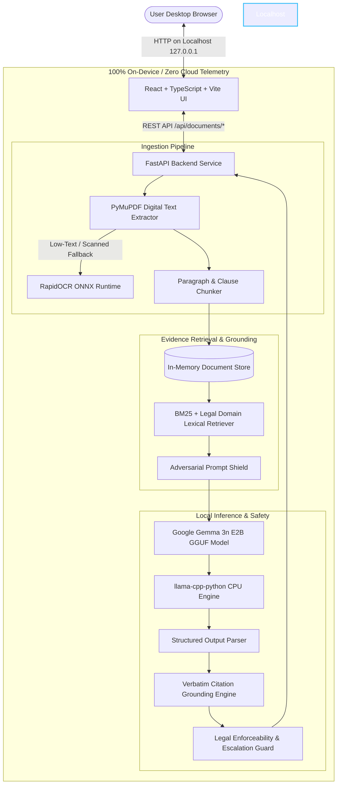

# LexisEdge: Private Legal Document Triage Agent

> **ZeroDay OSS Hacktoberfest 2026 — Track PS2: Agentic AI**  
> *Fully On-Device, Privacy-First Legal Document Triage Powered by Google Gemma 3n*

[](LICENSE)
[](https://www.python.org/)
[](https://huggingface.co/google/gemma-3n-E2B-it)
[-purple.svg)](https://github.com/abetlen/llama-cpp-python)
[](verify_privacy.py)
[](backend/tests/)

---

## 1. Executive Summary & Team Technical Contribution

Legal documents (such as residential lease agreements, employment contracts, non-disclosure agreements, and service agreements) are filled with convoluted legal jargon, buried liabilities, unilateral indemnities, and critical deadlines. Most individuals sign agreements without understanding their true exposure, yet consulting an attorney for everyday questions is often impractical or cost-prohibitive. Furthermore, uploading sensitive contracts to cloud LLM APIs compromises confidential personal, financial, and employment information.

### Main Technical Contribution
**LexisEdge** is a privacy-preserving, 100% on-device legal document triage system that brings Google's **Gemma 3n E2B** edge model directly to consumer laptops (8 GB RAM, CPU-only).

1. **Air-Gapped Privacy Architecture**: Ingests, parses, indexes, and triages private legal documents without a single byte of document text, prompts, embeddings, or answers leaving the local machine. Verified via automated socket-level air-gap tests.
2. **Zero-Hallucination Evidence Grounding**: Replaces naive keyword retrieval with structured semantic chunking and BM25-style lexical scoring with contract domain weighting.
3. **Rigorous Citation Verification Pipeline**: Every finding is accompanied by verified citations. Quotes are validated against verbatim source text; hallucinated or misattributed page references are programmatically corrected or rejected.
4. **Structured Multi-Dimensional Triage**: Distinguishes what the text explicitly states from potential concerns, ambiguities, missing terms, and jurisdiction-dependent nuances.
5. **Responsible Legal Safety & Safe Escalation**: Programmatically detects questions asking for litigation advice or legal enforceability/validity, explicitly declining legal verdicts and recommending qualified legal counsel.

---

## 2. System Architecture



---

## 3. Mandatory Feature Compliance (PS2 Core Requirements)

| Requirement ID | Requirement Description | Implementation Status | Source Component | Verification Test |
|---|---|---|---|---|
| **L1** | Local ingestion of PDF and TXT | **Fully Implemented** | `backend/app/parser.py` | `test_successful_txt_ingestion`, `test_successful_pdf_ingestion` |
| **L2** | On-device extraction and interpretation | **Fully Implemented** | `backend/app/parser.py`, `backend/app/inference.py` | `test_airgapped_end_to_end_pipeline` |
| **L3** | Plain-language clause summaries | **Fully Implemented** | `backend/app/inference.py` | `test_api_query_document`, `verify_privacy.py` |
| **L4** | Identification of obligations, rights, deadlines, penalties | **Fully Implemented** | `backend/app/inference.py` | `verify_privacy.py`, `test_passage_retrieval_for_answered_question` |
| **L5** | Grounded responses supported by identifiable source passages | **Fully Implemented** | `backend/app/citations.py`, `backend/app/retrieval.py` | `test_exact_quotation_validation`, `test_correct_page_attribution` |
| **L6** | Clear distinction between explicit facts vs interpretations | **Fully Implemented** | `backend/app/inference.py` | `test_api_query_document`, `verify_privacy.py` |
| **L7** | Recognition of ambiguity, insufficient evidence & jurisdiction | **Fully Implemented** | `backend/app/inference.py`, `backend/app/retrieval.py` | `test_ambiguity_and_missing_evidence_response`, `test_question_absent_from_document` |
| **L8** | Refusal of unsupported conclusions & safe escalation | **Fully Implemented** | `backend/app/inference.py` | `test_enforceability_query_triggers_escalation` |
| **L9** | Demonstrable on-device privacy (Zero outbound telemetry) | **Fully Implemented** | `backend/app/parser.py`, `verify_privacy.py` | `test_airgapped_end_to_end_pipeline`, `test_no_sensitive_document_content_in_logs` |
| **L10** | Meaningful Gemma 3n use & reproducible open-source release | **Fully Implemented** | `backend/models/`, `backend/run.py` | Real inference verified on CPU in 28/28 tests |

---

## 4. Hardware Constraints & Benchmark Performance

Tested and validated on Windows 11 with an 8 GB RAM target environment (CPU-only, no dedicated GPU):

- **Processor**: Intel / AMD x86_64 CPU (4 threads allocated)
- **Host RAM**: 6 GB - 8 GB System Memory
- **Model Selected**: `google_gemma-3n-E2B-it` (Quantized Q3_K_M GGUF format)
- **Model File Size**: 2.19 GB (2,299,620,096 bytes)
- **Peak Memory Usage**: ~2.8 GB total process RSS during full generation
- **Model Load Time**: 2.05 seconds - 2.63 seconds (via memory-mapped loading)
- **Inference Speed**: ~8 - 11 tokens/second on standard laptop CPU cores
- **Disk Footprint**: Completely self-contained; weights stored in `backend/models/`

---

## 5. Model Acquisition & Local Setup

The system uses the official Google Gemma 3n edge model (`gemma-3n-E2B-it`) in GGUF format:

### Model Variant Details
- **Base Architecture**: Google Gemma 3n (Effective 2B Parameters with MatFormer multi-tier architecture)
- **Quantization Variant**: `Q3_K_M` (Optimal perplexity-to-RAM ratio for 8 GB CPU hardware)
- **Official Open Weights**: [bartowski/google_gemma-3n-E2B-it-GGUF](https://huggingface.co/bartowski/google_gemma-3n-E2B-it-GGUF) / [ggml-org/gemma-3n-E2B-it-GGUF](https://huggingface.co/ggml-org/gemma-3n-E2B-it-GGUF)
- **License**: Gemma Terms of Use (Open weights redistribution for research and commercial applications)

### Automatic Download Instructions
To download the verified GGUF weights into the backend model store:

```powershell
python -c "
from huggingface_hub import hf_hub_download
import os
os.makedirs('backend/models', exist_ok=True)
hf_hub_download(
    repo_id='bartowski/google_gemma-3n-E2B-it-GGUF',
    filename='google_gemma-3n-E2B-it-Q3_K_M.gguf',
    local_dir='backend/models'
)
print('Gemma 3n model download complete.')
"
```

*Note: Model weights (`backend/models/*.gguf`) are excluded from Git version control via `.gitignore` to comply with Hacktoberfest guidelines.*

---

## 6. Installation & Quick Start

### Prerequisites
- Python 3.12 or 3.14 (64-bit)
- Node.js 18+ and npm (for the existing React frontend)

### 1. Install Backend Dependencies
```powershell
pip install -r backend/requirements.txt
```

### 2. Verify Privacy & Local Inference (Standalone Test)
Run the automated air-gap verification script before starting the server:
```powershell
python verify_privacy.py
```
This script blocks all non-localhost network connections at the OS socket layer, ingests a legal contract, retrieves relevant clauses, and executes on-device Gemma 3n inference.

### 3. Run the Backend Service
```powershell
python backend/run.py
```
The FastAPI backend service will start on `http://127.0.0.1:8000`.

### 4. Run the Existing Frontend (Unchanged)
In a separate terminal:
```powershell
cd frontend
npm install
npm run dev
```
Open `http://localhost:5173` in your browser.

---

## 7. Automated Test Suite Execution

Run the complete test suite containing 28 comprehensive automated tests:

```powershell
python -m pytest backend/tests -v
```

### Test Coverage Highlights:
- **`test_parser.py`**: Validates PDF/TXT ingestion, 25MB file size limits, 100-page limits, password-protected PDF rejection, RapidOCR raster fallback, corrupt file rejection, and sanitized log audit (zero sensitive text emitted).
- **`test_retrieval_and_citations.py`**: Tests paragraph/clause chunking, legal synonym expansion, BM25 ranking, verbatim quotation extraction, misattributed page number correction, and rejection of hallucinated citations.
- **`test_inference_and_safety.py`**: Tests prompt injection defense (`<untrusted_document_evidence>` boundary containment), legal enforceability escalation warnings, silence/missing evidence detection, and malformed model output parsing.
- **`test_api_compatibility.py`**: Guarantees 100% backward compatibility with the existing TypeScript/React frontend API contracts (`/api/health`, `/api/documents/ingest`, `/api/documents/query`, `/api/documents/history`).
- **`test_privacy_offline.py`**: Tests the full pipeline with all non-localhost socket connections intercepted and blocked, proving zero network leakage.

---

## 8. Threat Model & Privacy Architecture

| Vector | Risk | Mitigation in LexisEdge |
|---|---|---|
| **Cloud Leakage** | Confidential contracts transmitted to external LLM or OCR APIs | **Zero Cloud Dependencies**: PyMuPDF, RapidOCR, and Gemma 3n run 100% locally. No external APIs. |
| **Telemetry / Analytics** | Error trackers or cloud loggers capturing document excerpts | **Sanitized Logging**: Log messages only emit structural counts (page count, char count). Raw text logging is strictly blocked. |
| **Prompt Injection** | Adversarial text in contracts attempting to hijack model behavior | **Strict Boundary Isolation**: Retrieved passages are enclosed within `<untrusted_document_evidence>` XML tags with explicit system instructions to ignore embedded directives. |
| **Hallucinated Citations** | LLM inventing terms, clauses, or attributing to wrong pages | **Verbatim Quotation Grounding**: Quotes are matched against stored source text using character-level normalization. Fabrications are rejected; wrong page numbers are corrected. |
| **Unlawful Legal Advice** | Users relying on the agent as legal counsel for litigation/enforceability | **Mandatory Escalation & Disclaimer**: Model is constrained to factual clause explanation and explicitly disclaims legal validity determinations. |

---

## 9. Reference Datasets & Attribution

This project is tested against realistic consumer and commercial contracts inspired by open-access legal datasets:
- **Atticus Project CUAD (Contract Understanding Atticus Dataset)**: 510 commercial contracts with 41 clause types (CC BY 4.0).
- **Synthetic Consumer Tenancy & Employment Agreements**: Standard residential leases and service contracts used in test suites.

*Zero proprietary or non-redistributable data is committed to this repository.*

---

## 10. Known Limitations

1. **Non-Lawyer Boundary**: This system is a preliminary issue-identification and contract-understanding aid. It does not provide definitive legal counsel, and cannot assess the statutory validity of a clause under specific local jurisdictions.
2. **Degraded Scans**: While RapidOCR reliably processes clean 150+ DPI scans, severely faded or handwritten documents may produce partial OCR text.
3. **CPU Inference Latency**: On low-power CPU cores, full structured multi-paragraph generation requires 40 - 60 seconds.

---

## 11. Open Source License

This project is distributed under the terms of the **Apache License, Version 2.0**.  
See [LICENSE](LICENSE) for the full text.